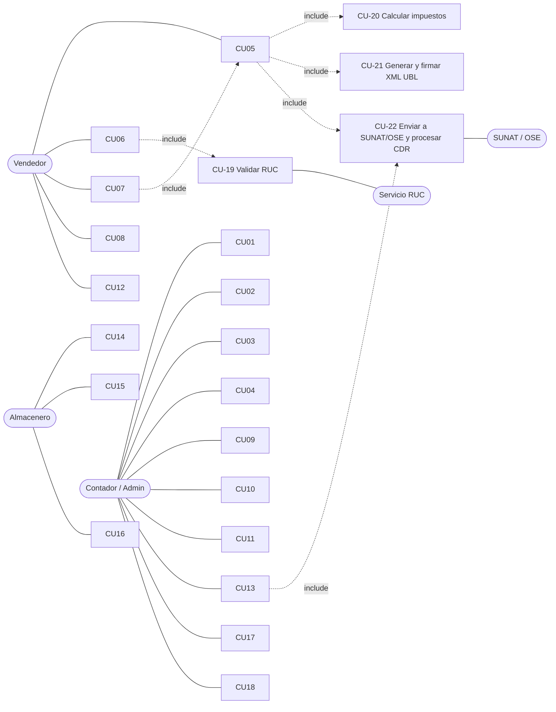

# 02 · Descubrimiento de casos de uso

## 1. Actores

| Actor | Rol |
|---|---|
| **Vendedor/Cajero** | Emite facturas y boletas, consulta clientes y productos. |
| **Almacenero** | Registra ingresos/salidas; consulta kardex. |
| **Contador/Administrador** | Configura emisor, series, certificado; revisa rechazos; reportes y libros. |
| **SUNAT / OSE** (sistema externo) | Recibe comprobantes, devuelve CDR. |
| **Servicio de consulta RUC** (sistema externo) | Valida RUC/razón social (padrón SUNAT o proveedor). |
| **Migrador legado** (proceso) | Importa fichas del software antiguo. |

## 2. Diagrama de casos de uso

## 3. Catálogo de casos de uso

| ID | Caso de uso | Actor | Resultado | Reglas |
|---|---|---|---|---|
| CU-01 | Configurar emisor (RUC, razón social, domicilio fiscal, UBIGEO, modo SEE/OSE, entorno beta/prod) | Admin | Emisor válido | RN-010 |
| CU-02 | Cargar certificado digital y credenciales SOL | Admin | Secretos en almacén seguro | ADR-06 |
| CU-03 | Gestionar series y correlativos | Admin | Series `F###`/`B###` por establecimiento | RN-001, RN-002 |
| CU-04 | Mantener catálogos y parámetros tributarios con vigencia | Admin | IGV, ICBPER, umbral, plazos | ADR-05 |
| **CU-05** | **Emitir Factura (01)** | Vendedor | Comprobante `ACEPTADO` + XML firmado + CDR + PDF | RN-001…RN-006, RN-020…RN-045 |
| **CU-06** | **Emitir Boleta (03)** | Vendedor | Boleta emitida; entra al Resumen Diario | RN-005, RN-006 |
| CU-07 | Emitir Nota de Crédito (07) / Débito (08) | Vendedor/Admin | Nota vinculada al documento origen | RN-004 |
| CU-08 | Emitir comprobante con operación gratuita / exportación / anticipo | Vendedor | Cálculo y leyendas correctos | RN-030…RN-036 |
| CU-09 | Generar y enviar **Resumen Diario** de boletas (RC) | Admin/proceso | Ticket + CDR | RN-006 |
| CU-10 | **Comunicación de Baja** (RA) de facturas | Admin | Documento anulado | RN-007 |
| CU-11 | Reenviar / reconsultar estado (`getStatus`, `getStatusCdr`) | Admin | Estado consistente | EP-12 |
| CU-12 | Consultar y reimprimir comprobante (PDF/XML/CDR) | Vendedor | Archivos descargables | — |
| CU-13 | Reintentar envíos pendientes (cola offline) | Proceso | Sin pérdida ante caída de red | RN-050 |
| CU-14 | Registrar ingreso de mercadería | Almacenero | Movimiento `INGRESO` en kardex | RN-060 |
| CU-15 | Registrar salida (venta o ajuste) | Almacenero | Movimiento `SALIDA`; baja de stock | RN-060, RN-061 |
| CU-16 | Consultar kardex / inventario permanente | Almacenero | Reporte valorizado (RS 234-2006) | RN-062 |
| CU-17 | **Migrar datos del software legado** | Admin | Reporte de mapeo sin pérdida de trazabilidad | RN-070…RN-075 |
| CU-18 | Reportes: Registro de Ventas, auditoría de rechazos | Contador | CSV/PDF | — |
| CU-19 | Validar RUC (formato + dígito verificador + estado SUNAT) | sistema | RUC válido o error con causa | RN-010 |
| CU-20 | Calcular IGV/ISC/ICBPER y totales | sistema | Totales consistentes | RN-020…RN-045 |
| CU-21 | Generar y firmar XML UBL 2.1 | sistema | XML válido contra XSD + firma XMLDSig | RN-003, TR-xxx |
| CU-22 | Enviar a SUNAT/OSE, procesar CDR | sistema | Estado + CDR persistidos | §4 de `01-…` |

### Flujo principal CU-05 (Emitir Factura) — ejemplo de especificación de caso de uso

1. El vendedor selecciona/crea cliente → **CU-19** valida RUC (RN-010).
2. Agrega ítems; el sistema propone afectación IGV por producto (cat. 07), ISC (cat. 08) e ICBPER.
3. **CU-20** calcula líneas y totales; añade leyenda 1000 (monto en letras).
4. El sistema reserva el siguiente correlativo de la serie (atómico).
5. **CU-21** genera el XML UBL 2.1, lo valida contra XSD y reglas SUNAT, lo firma.
6. **CU-22** envía a SUNAT/OSE; recibe CDR; guarda estado.
7. Registra la **salida de almacén** (CU-15) en la misma transacción lógica.
8. Devuelve comprobante + PDF.

**Flujos alternos**: A1 RUC inválido → error `RUC_INVALIDO`, no consume correlativo. A2 sin red → estado `PENDIENTE_ENVIO`, entra a cola (CU-13). A3 rechazo SUNAT (2xxx/3xxx) → estado `RECHAZADO`, correlativo no se reutiliza; se emite uno nuevo. A4 observación (4xxx) → `ACEPTADO_CON_OBS`.

## 4. Benchmark con software del mercado (Nubefact)

El enunciado pide revisar software en línea (Nubefact con usuario DEMO). **Yo no puedo crear la cuenta por ti**; hazlo tú y marca en esta lista lo que observes.

Casos de uso típicos del rubro (deben contrastarse en tu DEMO) y su mapeo:

| Función observada en software de facturación | CU propio | ¿Validado en DEMO? |
|---|---|---|
| Emisión de factura / boleta | CU-05 / CU-06 | ☐ |
| Notas de crédito/débito con motivos | CU-07 | ☐ |
| Anulación / comunicación de baja | CU-10 | ☐ |
| Resumen diario de boletas | CU-09 | ☐ |
| Guía de remisión electrónica | **Fuera de alcance fase 1** (cat. 20/18 documentados) | ☐ |
| Consulta de RUC/DNI al digitar cliente | CU-19 | ☐ |
| Catálogo de productos con afectación IGV | CU-04 / dominio `Producto` | ☐ |
| Series configurables | CU-03 | ☐ |
| Envío del PDF/XML por correo y reimpresión | CU-12 | ☐ |
| Integración por API (JSON) | EP-05 | ☐ |
| Modo contingencia / reintentos | CU-13 | ☐ |
| Reportes de ventas | CU-18 | ☐ |

**Acción para ti (5 min)**: entra al DEMO, recorre cada fila y marca ☑. Anota 2–3 hallazgos extra (p. ej. campos que no previmos) y agrégalos como casos de uso nuevos con la numeración siguiente.

## 5. Alcance (fase 1)

**Incluye**: CU-01…CU-22. **Excluye**: guía de remisión, retenciones/percepciones, detracciones (se deja el punto de extensión en el esquema), contabilidad, multi-empresa.
