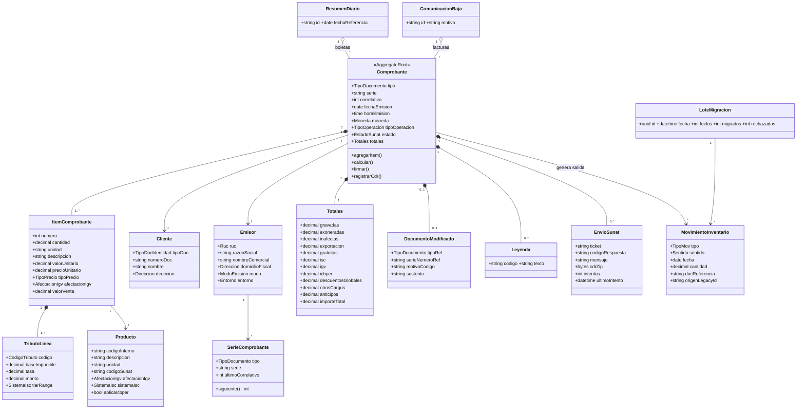
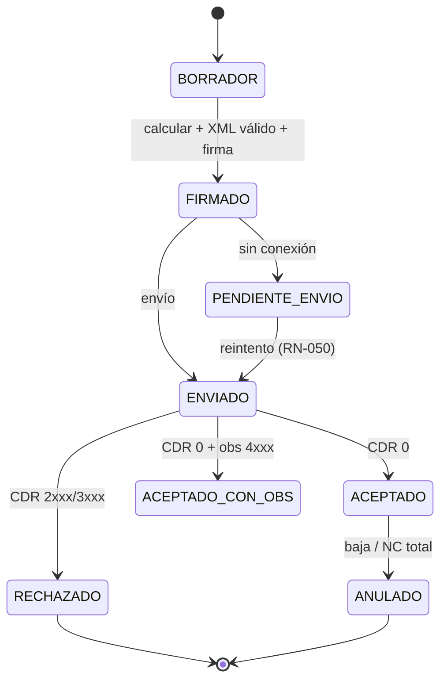

# 03 · Modelo de dominio y reglas de negocio

## 1. Bounded contexts (monolito modular)

| Contexto | Responsabilidad | Agregados raíz |
|---|---|---|
| **Facturación** | Emitir, firmar, enviar y custodiar comprobantes | `Comprobante`, `ResumenDiario`, `ComunicacionBaja` |
| **Maestros** | Datos de referencia | `Emisor`, `Cliente`, `Producto`, `SerieComprobante`, `ParametroTributario` |
| **Almacén** | Stock e inventario permanente | `MovimientoInventario` |
| **Migración** | Importar legado con trazabilidad | `LoteMigracion` |

## 2. Diagrama de clases (dominio)

## 3. Máquina de estados del Comprobante

## 4. Reglas de negocio y validaciones (RN)

### 4.1 Identificación (RN-01x)
| ID | Regla | Error |
|---|---|---|
| RN-010 | **RUC**: 11 dígitos; prefijo ∈ {10,15,16,17,20}; dígito verificador módulo 11 con pesos `5,4,3,2,7,6,5,4,3,2` → `d = 11 − (S mod 11)`; si d=10→0, d=11→1. | `RUC_INVALIDO` |
| RN-011 | DNI: 8 dígitos. C. extranjería: ≤12 alfanum. Pasaporte: ≤12 alfanum. | `DOC_INVALIDO` |
| RN-012 | Factura ⇒ `tipoDoc=6` (RUC) salvo exportación (cat. 06 ≠ 6 permitido). | `ADQUIRENTE_NO_VALIDO` |
| RN-013 | UBIGEO: 6 dígitos existentes en catálogo INEI. | `UBIGEO_INVALIDO` |

### 4.2 Cálculo (RN-02x)
| ID | Regla |
|---|---|
| RN-020 | `IGV = round(baseIGV × tasaIGV, 2)`; `tasaIGV` = parámetro vigente (18 %). |
| RN-021 | **Redondeo por línea** a 2 decimales (half-up); `valorVenta = round(cantidad × valorUnitario − descuentoLínea, 2)`. |
| RN-022 | Totales = suma de líneas por tipo de afectación. `importeTotal = gravadas + exoneradas + inafectas + exportación + IGV + ISC + ICBPER + otrosCargos − descuentosGlobales − anticipos`. Gratuitas **no** suman. |
| RN-023 | `precioUnitario` (cat. 16 = 01) = `valorUnitario × (1 + tasas aplicables)`; coherencia verificada con tolerancia configurable (default ±0.01 por línea). |
| RN-024 | Todo monto de moneda: `n(12,2)`; cantidades/precios unitarios: hasta `n(12,10)`. |

### 4.3 Afectación IGV y operaciones especiales (RN-03x)
| ID | Regla |
|---|---|
| RN-030 | Afectación 10–17 ⇒ tributo 1000 (IGV) con tasa; 20–21 ⇒ 9997; 30–36 ⇒ 9998; 40 ⇒ 9995. |
| RN-031 | Operaciones gratuitas (11–16, 21, 31–36): `tipoPrecio=02` (valor referencial), no suman al importe total, leyenda **1002** obligatoria. |
| RN-032 | Exportación (40): `tipoOperacion=0102`, IGV=0. |
| RN-033 | Anticipos (`0104`): referencia al comprobante de anticipo (`cac:PrepaidPayment`, cat. 12). |
| RN-034 | Descuentos/cargos globales y por ítem con código cat. 53; `factor × base = monto`. |
| RN-035 | Una factura mezcla afectaciones distintas por línea; los totales se agrupan por afectación. |
| RN-036 | Moneda ≠ PEN requiere tipo de cambio informativo (parámetro). |

### 4.4 ISC e ICBPER (RN-04x) — **catálogo 8**
| ID | Regla |
|---|---|
| RN-040 | El producto con ISC declara `sistemaIsc ∈ {01,02,03}` (cat. 08). El cálculo es una **estrategia**: `IscAlValor` (base × tasa), `IscMontoFijo` (cantidad × monto), `IscPrecioVentaPublico` (⚠ fórmula a confirmar en TUO IGV/ISC, Apéndice IV lit. C). Se emite en XML en `cac:TaxCategory/cbc:TierRange`. |
| RN-041 | `baseIGV = valorVenta + ISC` (el ISC integra la base del IGV). |
| RN-042 | ICBPER: `monto = nroBolsas × tarifaVigente`; código tributo `7152`; **no** integra la base de IGV; el ítem de bolsas es una línea propia. |
| RN-043 | Producto con `sistemaIsc` ≠ null pero sin tasa/monto parametrizado ⇒ error `ISC_SIN_PARAMETRO`. |
| RN-044 | Un ítem no puede tener IGV 1000 y ser exonerado/inafecto a la vez (excluyentes, RN-030). |
| RN-045 | **Leyenda 1000** (monto en letras) obligatoria; formato “SON: <letras> <moneda>”. |

### 4.5 Envío y resiliencia (RN-05x)
| ID | Regla |
|---|---|
| RN-050 | Si falla la red, el comprobante firmado queda `PENDIENTE_ENVIO` y se reintenta con *backoff*; plazo máximo de envío = parámetro (default 3 días ⚠ VERIFICAR RS 003-2023). |
| RN-051 | Un correlativo consumido **no se reutiliza** aunque el documento sea rechazado. |
| RN-052 | Idempotencia: reenviar un comprobante `ENVIADO` consulta `getStatus/CDR` en vez de reenviar. |
| RN-053 | El XML firmado y el CDR se almacenan **inmutables** (hash SHA-256 en el registro). |

### 4.6 Almacén (RN-06x)
| ID | Regla |
|---|---|
| RN-060 | Todo movimiento tiene fecha, producto, cantidad > 0, tipo y documento de referencia. |
| RN-061 | Emitir un comprobante con ítems inventariables genera `SALIDA` por ítem; un NC por devolución genera `INGRESO`. |
| RN-062 | El kardex valoriza por costo promedio (⚠ definir método con contabilidad; RS 234-2006 exige Registro de Inventario Permanente). |
| RN-063 | Un `AJUSTE` declara `sentido` (`AUMENTO` o `DISMINUCION`), obligatorio sólo en ajustes; `INGRESO` y `SALIDA` no lo llevan. La cantidad sigue siendo > 0 (RN-060). Saldo = Σ `INGRESO` + Σ `AJUSTE AUMENTO` − Σ `SALIDA` − Σ `AJUSTE DISMINUCION`. |

### 4.7 Migración (RN-07x) → ver `05-migracion-legado.md`
| ID | Regla |
|---|---|
| RN-070 | Cada fila legada se conserva con `origenLegacyId` y valores originales (`campo_original`) — **nada se pierde**. |
| RN-071 | `nro_documento` legado no válido como comprobante ⇒ se guarda como `docReferencia` tipo `INTERNO`, jamás se convierte en serie-correlativo SUNAT. |
| RN-072 | Ingreso y salida legados se mapean a `MovimientoInventario(INGRESO|SALIDA)`. |
| RN-073 | Producto legado por nombre libre ⇒ se normaliza y se crea `Producto` con `codigoInterno` generado; ambigüedades pasan a cola de revisión. |
| RN-074 | Migración **idempotente**: re-ejecutar no duplica (clave `origenLegacyId`). |
| RN-075 | Se emite reporte `leidos = migrados + rechazados`; todo rechazo lleva causa. |

## 5. Contratos derivados (siguiente paso)
Cada entidad y regla anterior se materializa como JSON Schema en `specs/contracts/schemas/`; las reglas que no se pueden expresar en JSON Schema (RUC módulo 11, sumas de totales, ISC) se documentan como **validaciones de aplicación** en cada schema vía la anotación `x-reglas`.
