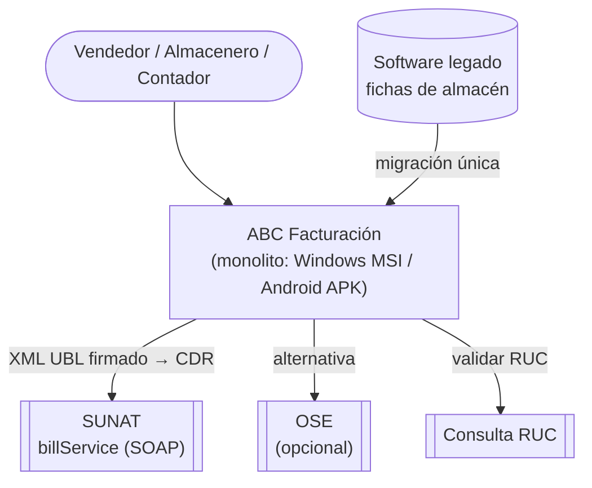
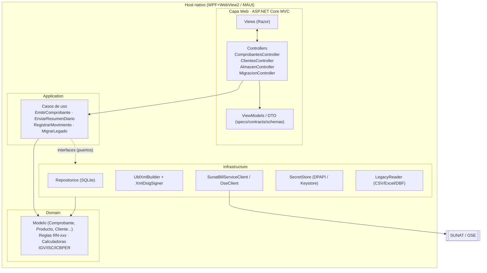
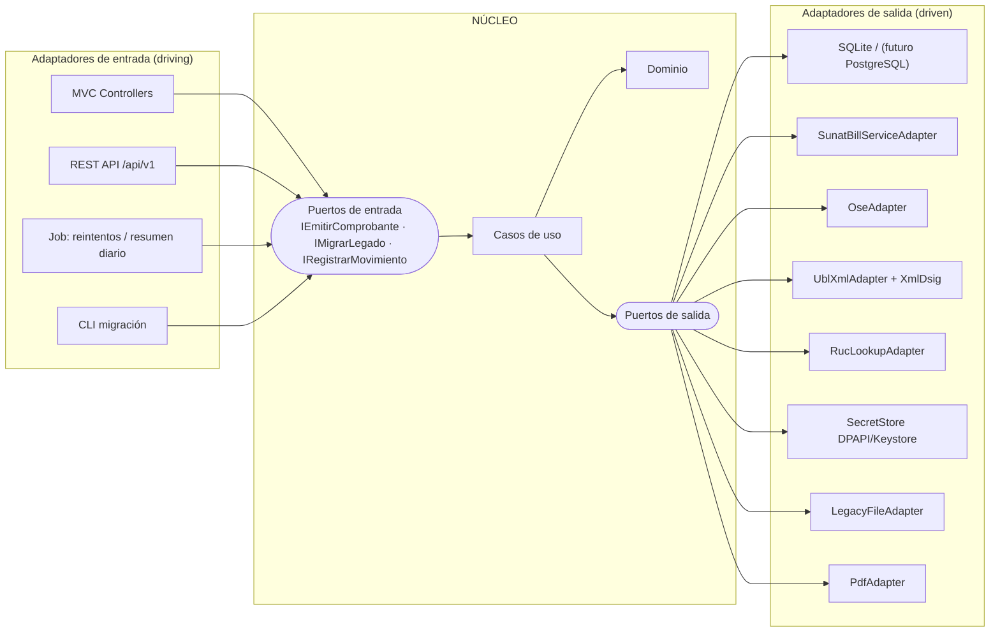
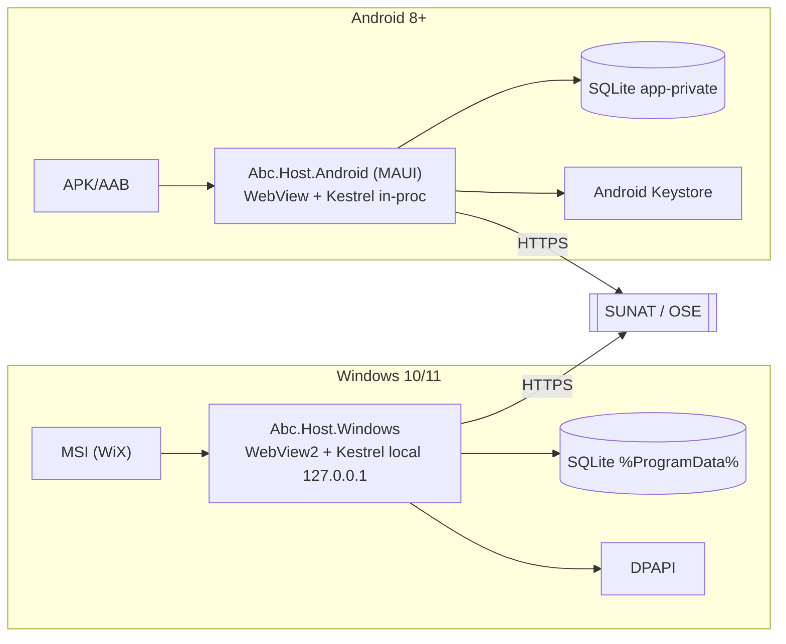

# 04 · Arquitectura: MVC monolítico hoy, Hexagonal mañana

## 1. Idea central

> **MVC es sólo la capa de entrada.** El negocio vive en un núcleo que no conoce MVC, ni SQLite, ni SOAP, ni Windows/Android. Así, pasar a Hexagonal/Clean y luego a microservicios es *mover fronteras que ya existen*, no reescribir.

Regla de dependencias (inviolable, verificable con tests de arquitectura):

```
Web(MVC) ─► Application ─► Domain
Infrastructure ─► Application(puertos) , Domain
Domain ─► (nada)
```

## 2. Vista 1 · Contexto (C4 nivel 1)



## 3. Vista 2 · Arquitectura MVC monolítica (fase actual)



En MVC clásico: **Model** = Domain + Application, **View** = Razor, **Controller** = adaptador de entrada delgado (valida forma, delega, mapea resultado).

## 4. Vista 3 · Objetivo Hexagonal / Clean



### 4.1 Catálogo de puertos

| ID | Puerto | Dirección | Contrato | Adaptador inicial |
|---|---|---|---|---|
| PT-01 | `IEmitirComprobante` | entrada | `ComprobanteEmitirRequest → ComprobanteResponse` | MVC Controller / REST |
| PT-02 | `IEnviarLote` (RC/RA) | entrada | `ResumenDiarioRequest`, `ComunicacionBajaRequest` | Job + UI |
| PT-03 | `IMigrarLegado` | entrada | `MigracionRequest → LoteMigracionResponse` | MVC + CLI |
| PT-04 | `IRegistrarMovimiento` | entrada | `MovimientoInventario` | MVC |
| PT-10 | `IComprobanteRepository` | salida | CRUD + `siguienteCorrelativo(serie)` atómico | SQLite |
| PT-11 | `IGeneradorUbl` | salida | `Comprobante → XML UBL 2.1` | `UblXmlAdapter` |
| PT-12 | `IFirmaDigital` | salida | XML → XML firmado XMLDSig | `XmlDsigAdapter` |
| PT-13 | `IEnvioComprobantePort` | salida | `sendBill`, `sendSummary`, `getStatus`, `getStatusCdr` | `SunatBillServiceAdapter` / `OseAdapter` |
| PT-14 | `IConsultaRucPort` | salida | `ruc → {estado, condición, razónSocial}` | `RucLookupAdapter` |
| PT-15 | `ISecretStorePort` | salida | credenciales SOL, .pfx | DPAPI / Keystore |
| PT-16 | `ILegacyReaderPort` | salida | stream de `FichaLegado` | CSV/Excel/DBF |
| PT-17 | `IRelojPort`, `IPdfPort`, `IParametrosPort` | salida | fecha/hora, PDF, parámetros vigentes | — |

> Los contratos de entrada son **los JSON Schema** del paso 4 ⇒ el mismo DTO sirve a MVC, REST y a un futuro microservicio.

## 5. Estructura de proyecto (desacople verificable)

```
src/
  Abc.Domain/            # entidades, value objects, calculadoras, reglas RN (sin referencias externas)
  Abc.Application/       # casos de uso + interfaces de puertos + DTOs
  Abc.Infrastructure/    # EF/SQLite, Ubl, XmlDsig, SunatClient, SecretStore, LegacyReader
  Abc.Web/               # ASP.NET Core MVC: Controllers, Views, ViewModels, API
  Abc.Host.Windows/      # WPF/WebView2 + instalador WiX (MSI)
  Abc.Host.Android/      # MAUI + APK
tests/
  Abc.Domain.Tests/ · Abc.Application.Tests/ · Abc.Architecture.Tests/ (NetArchTest)
```

**Tests de arquitectura (spec ejecutable)**: `Domain` no referencia nada; `Application` sólo referencia `Domain`; `Web` no referencia `Infrastructure` (salvo en el *composition root*).

## 6. Mapa de migración MVC → Hexagonal → Microservicios

| Etapa | Cambio | Qué NO cambia |
|---|---|---|
| **Hoy** (monolito MVC) | Controllers llaman casos de uso; BD SQLite local | — |
| **Etapa 2** (hexagonal explícito) | Agregar adaptador REST y jobs como entradas; cambiar SQLite por servidor | Dominio, casos de uso, DTOs |
| **Etapa 3** (microservicios) | Extraer contextos: **Facturación** (emisión/envío), **Almacén**, **Maestros**; comunicación por eventos `ComprobanteAceptado` → Almacén | Contratos de puertos pasan a contratos de red (OpenAPI/eventos) |
| Cortes naturales | Cada *bounded context* de `03-modelo-dominio.md` §1 ya está en su propio módulo/namespace | — |

**Evento de dominio** (preparación a microservicios): `ComprobanteAceptado{id, items[], fecha}` consumido por Almacén para generar la salida (RN-061); hoy es una llamada en proceso, mañana un mensaje.

## 7. Vistas de despliegue (Windows y Android)



Kestrel enlazado **sólo a loopback** y con token de sesión por arranque (evita que otras apps del equipo/teléfono llamen al servidor local).

## 8. Requisitos no funcionales con criterio de aceptación

| RNF | Criterio |
|---|---|
| Integridad monetaria | 0 diferencias de centavos en 10 000 comprobantes de prueba (decimal exacto, ADR-04) |
| Offline | Emitir sin red; envío diferido sin perder correlativo (RN-050/051) |
| Seguridad | Clave SOL y .pfx nunca en texto plano ni en logs |
| Trazabilidad | Todo XML/CDR con hash SHA-256 inmutable (RN-053) |
| Portabilidad | Mismo núcleo compila para Windows y Android; 0 `#if` en Domain/Application |
| Auditabilidad | Cada rechazo SUNAT queda con código y mensaje |
