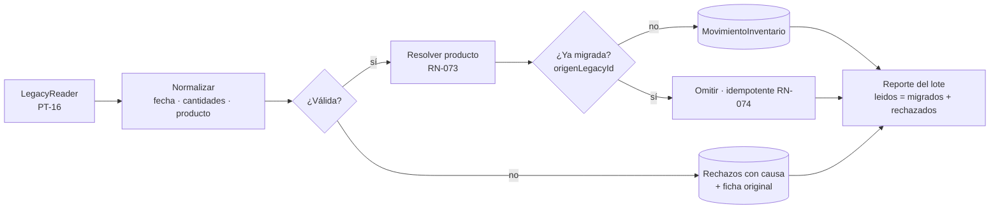

# 05 · Migración de datos del software legado

## 1. Punto de partida

Fichas sencillas con: `fecha`, `ingreso`, `salida`, `producto`, `nro_documento` (interno e informal). Contrato: `DTO-FichaLegado` en [`almacen-migracion.schema.json`](../specs/contracts/schemas/almacen-migracion.schema.json).

**Meta**: que *toda* ficha termine como `MovimientoInventario` **o** como rechazo explicado, **sin pérdida de trazabilidad** (RN-070…RN-075).

## 2. Mapeo campo a campo

| Legado | Destino | Transformación | Regla |
|---|---|---|---|
| (clave fila / hash) | `MovimientoInventario.origenLegacyId` | Clave estable: PK origen o `SHA-256(fila normalizada)` | RN-074 |
| `fecha` | `MovimientoInventario.fecha` | Parseo tolerante (`dd/mm/aaaa`, `aaaa-mm-dd`, serial Excel); inválida ⇒ rechazo `FECHA_INVALIDA` | RN-075 |
| `ingreso` > 0 | `tipo = INGRESO`, `cantidad = ingreso` | Decimal; texto con coma → punto | RN-072 |
| `salida` > 0 | `tipo = SALIDA`, `cantidad = salida` | idem | RN-072 |
| `ingreso` y `salida` ambos > 0 | — | Rechazo `INGRESO_Y_SALIDA_A_LA_VEZ` (o dividir en 2 movimientos si el usuario lo aprueba) | RN-075 |
| ambos vacíos/0 | — | Rechazo `SIN_MOVIMIENTO` | RN-075 |
| `producto` (texto libre) | `productoId` → `Producto` | Normalizar (trim, mayúsculas, sin tildes); buscar por nombre normalizado; si no existe se crea con `codigoInterno` autogenerado, `afectacionIgv` provisional `10` y `pendienteTributario=true` ; si hay 2+ coincidencias ⇒ `PRODUCTO_AMBIGUO` | RN-073 |
| `nro_documento` | `docReferencia = {tipo: INTERNO_LEGADO, numero}` | **Nunca** se interpreta como serie-correlativo SUNAT | RN-071 |
| fila completa | `datosOriginales` | Copia íntegra | RN-070 |

## 3. Pipeline

## 4. Modos y seguridad

- **SIMULACIÓN** (`dry-run`): ejecuta todo el pipeline en memoria y devuelve el reporte; **no escribe**. Se corre siempre antes de EJECUCIÓN.
- **EJECUCIÓN**: transacción por lote; si falla, *rollback* completo del lote.
- El archivo origen es **de sólo lectura**; se guarda copia con hash SHA-256 en el lote.
- Tras migrar, el kardex debe reproducir los **saldos del legado** por producto (criterio de aceptación §5).

## 5. Criterios de aceptación (verificables)

| # | Criterio |
|---|---|
| A1 | `leidos = migrados + rechazados` en todo lote (RN-075). |
| A2 | Re-ejecutar el mismo archivo ⇒ `migrados = 0` nuevos (idempotencia, RN-074). |
| A3 | Para cada producto, `Σ ingresos − Σ salidas` del kardex = saldo calculado con las fichas originales. |
| A4 | Ninguna fila legada aparece como comprobante SUNAT (RN-071). |
| A5 | Cada rechazo muestra `idOrigen`, `causa` y la `fichaOriginal`. |
| A6 | Los productos creados automáticamente quedan marcados `pendienteTributario=true` y **bloquean** su uso en facturación hasta completar afectación IGV/ISC. |

## 6. Relación con RS 234-2006

Las fichas de almacén son el antecedente del **Registro de Inventario Permanente**. El kardex migrado es la base para reportarlo; la valorización (costo promedio u otro método) se define con el área contable (RN-062).

## 7. Riesgos y preguntas abiertas

- ⚠ Formato real del archivo legado (CSV / Excel / DBF / SQLite) — define el adaptador `ILegacyReaderPort`.
- ⚠ ¿El legado tiene costos? No figuran en el enunciado; sin costos no hay valorización retroactiva.
- ⚠ Productos con nombres inconsistentes (“ARROZ 50KG” vs “Arroz saco 50 kg”): se resuelve con `mapeoProductos` asistido por el usuario.
