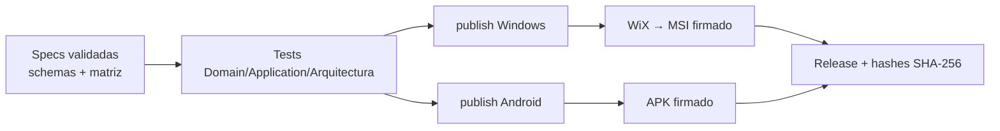

# 06 · Distribución multiplataforma y empaquetado (MSI / APK)

Requisito del enunciado: correr **nativo en Windows y Android**, empaquetado **obligatoriamente** en formato amigable: **instalador MSI** (escritorio) o **APK** (Android).

## 1. Matriz de entrega

| Plataforma | Host | Artefacto | Herramienta | Firma |
|---|---|---|---|---|
| Windows 10/11 x64 | `Abc.Host.Windows` (WPF + WebView2 + Kestrel loopback) | **`AbcFacturacion-x.y.z.msi`** | WiX Toolset (v4+) | Authenticode (certificado de firma de código) |
| Android 8.0+ (API 26+) | `Abc.Host.Android` (.NET MAUI + WebView + Kestrel in-proc) | **`AbcFacturacion-x.y.z.apk`** (y `.aab` si se publica en Play) | `dotnet publish -f net8.0-android` | Keystore de release (apksigner) |

> ⚠ La opción “MAUI nativo” en Windows produce **MSIX**, no MSI; por eso Windows usa un host propio + WiX. Es una decisión consciente (ADR-01) para cumplir “MSI” literalmente.

## 2. Contenido del MSI

| Componente | Destino |
|---|---|
| Binarios de la app (framework-dependent, o self-contained si se quiere sin prerrequisitos) | `%ProgramFiles%\ABC\Facturacion\` |
| Prerrequisito WebView2 Runtime | *bootstrapper* Evergreen incluido en el *bundle* |
| BD SQLite y archivos XML/CDR | `%ProgramData%\ABC\Facturacion\data\` (ACL: sólo usuarios autorizados) |
| Accesos directos, desinstalación limpia | Menú Inicio, Programas y características |
| Actualización | `MajorUpgrade` de WiX conservando `data\` |

Requisitos de aceptación: instala y desinstala sin dejar procesos; **no** borra `data\` en actualización; instalación silenciosa `msiexec /i AbcFacturacion.msi /qn`.

## 3. Contenido del APK
- `applicationId = pe.abc.facturacion`, `minSdk 26`.
- Permisos mínimos: `INTERNET`, `ACCESS_NETWORK_STATE`. Sin permisos de almacenamiento amplios (los archivos van en el sandbox de la app).
- Clave SOL y .pfx en **Android Keystore**; BD SQLite en almacenamiento privado de la app.
- Entrega: APK firmado para distribución directa; opcional AAB para Play.

## 4. Pipeline de build (CI)

Puerta de calidad: **no se genera instalador** si falla `validar-contratos.mjs`, `verificar-matriz.mjs` o los tests de arquitectura.

## 5. Matriz de portabilidad (qué difiere por plataforma)

| Aspecto | Windows | Android | Abstracción |
|---|---|---|---|
| Almacén de secretos | DPAPI | Keystore | `ISecretStorePort` |
| Ruta de datos | `%ProgramData%` | sandbox app | `IRutasPort` |
| Impresión/PDF | impresora + visor | compartir/visor | `IPdfPort` |
| Certificado .pfx | importar a almacén | importar a Keystore | `ISecretStorePort` |
| Segundo plano (reintentos) | Servicio/Tarea | WorkManager | `IJobSchedulerPort` |

El **núcleo no tiene `#if`**; todo lo específico está detrás de puertos (ver `04-arquitectura.md`).

## 6. Riesgos
- Kestrel embebido en Android es posible pero exige pruebas de ciclo de vida (la app pasa a segundo plano). **Plan B documentado**: invocar los casos de uso directamente desde MAUI sin servidor HTTP local (el núcleo ya lo permite por la arquitectura hexagonal).
- Firma XMLDSig (`System.Security.Cryptography.Xml`) debe probarse en ambos hosts con el mismo .pfx de prueba.
