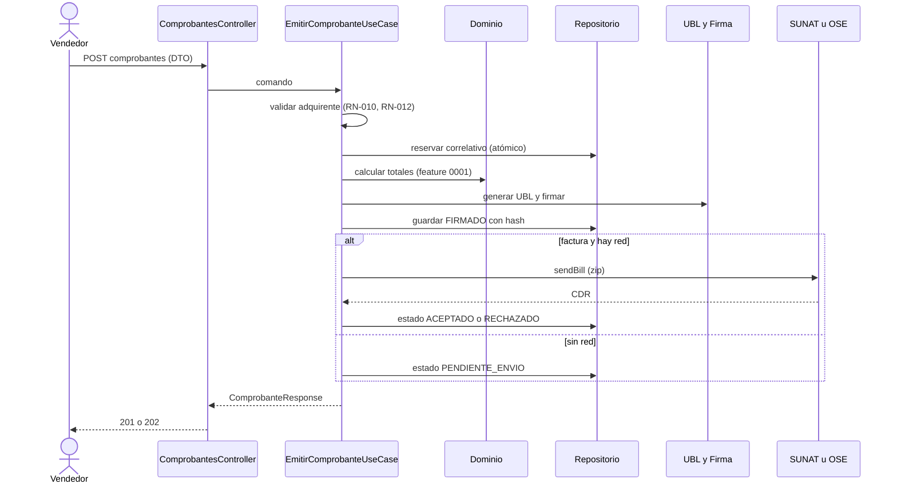

# Design 0002 · Emisión de Factura y Boleta

| Campo | Valor |
|---|---|
| **Spec asociada** | [`spec.md`](spec.md) |
| **Estado** | Propuesto |

## 1. Resumen de la solución
Un caso de uso `EmitirComprobante` orquesta validación → correlativo → cálculo → XML → firma → envío. MVC sólo lo invoca; todo lo externo (BD, SUNAT, firma, RUC) está detrás de puertos (ADR-02, ADR-03).

## 2. Componentes por capa
| Capa | Componente | Responsabilidad |
|---|---|---|
| Web (MVC) | `ComprobantesController` | Valida forma, llama al puerto de entrada PT-01, mapea resultado y errores (RFC 7807) |
| Application | `EmitirComprobanteUseCase` | Orquesta; transacción de correlativo; idempotencia |
| Application | `ReintentarPendientesUseCase` | Reenvía los `PENDIENTE_ENVIO` (RN-050) |
| Domain | `Comprobante` (agregado), `SerieComprobante`, calculadoras (0001) | Invariantes y estados |
| Infrastructure | `SqliteComprobanteRepository`, `UblXmlAdapter`, `XmlDsigAdapter`, `SunatBillServiceAdapter` / `OseAdapter`, `RucLookupAdapter` | Adaptadores de PT-10…PT-14 |

## 3. Puertos y adaptadores
| Puerto | Dirección | Adaptador inicial | Adaptador futuro |
|---|---|---|---|
| PT-01 `IEmitirComprobante` | entrada | MVC Controller | REST / cola |
| PT-10 `IComprobanteRepository` | salida | SQLite | PostgreSQL |
| PT-11 `IGeneradorUbl` | salida | Plantillas `Invoice` | — |
| PT-12 `IFirmaDigital` | salida | XmlDsig + .pfx | HSM / servicio de firma |
| PT-13 `IEnvioComprobantePort` | salida | `SunatBillServiceAdapter` | `OseAdapter` |
| PT-14 `IConsultaRucPort` | salida | Padrón SUNAT / proveedor | — |

## 4. Secuencia principal

## 5. Modelo de datos afectado
`Comprobante`, `ItemComprobante`, `TributoLinea`, `EnvioSunat`, `SerieComprobante` (con bloqueo optimista del correlativo) y una tabla de idempotencia (`idempotencyKey` único).

## 6. Alternativas consideradas
| Alternativa | Pros | Contras | Decisión |
|---|---|---|---|
| Reservar el correlativo al final | No quema números si falla | Dos emisiones simultáneas pueden chocar | Descartada |
| Reservar al inicio, en la misma transacción que guarda el borrador | Sin choques | Un rechazo consume número (RN-051) | **Elegida** |
| Enviar boletas una a una | Simplicidad | No es el flujo normativo (RN-006) | Descartada |

## 7. Riesgos y mitigaciones
Fallo a mitad de camino → estados explícitos y reintento idempotente (RN-052). Certificado vencido → `CERTIFICADO_INVALIDO` antes de consumir correlativo.

## 8. Impacto en migración a Hexagonal / microservicios
Es el candidato natural a microservicio **Facturación**; se relaciona con Almacén sólo por el evento `ComprobanteAceptado`.
