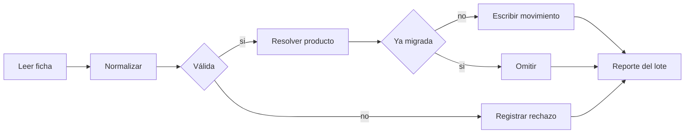

# Design 0006 · Migración del legado

| Campo | Valor |
|---|---|
| **Spec asociada** | [`spec.md`](spec.md) |
| **Estado** | Propuesto |

## 1. Resumen de la solución
Un caso de uso `MigrarLegado` lee fichas por un puerto, las normaliza, resuelve productos y escribe movimientos en una sola transacción por lote. Siempre existe una corrida de **simulación** que usa el mismo código sin escribir.

## 2. Componentes por capa
| Capa | Componente | Responsabilidad |
|---|---|---|
| Web (MVC) | `MigracionController` | Inicia lote, muestra reporte y rechazos |
| Application | `MigrarLegadoUseCase` | Orquesta el pipeline; modo simulación o ejecución |
| Domain | `NormalizadorFicha`, `ResolutorProducto`, `ReglasMigracion` | RN-070…RN-075 |
| Infrastructure | `CsvLegacyReader` / `ExcelLegacyReader` / `DbfLegacyReader` | Adaptadores de PT-16 |

## 3. Puertos y adaptadores
| Puerto | Dirección | Adaptador inicial | Adaptador futuro |
|---|---|---|---|
| PT-03 `IMigrarLegado` | entrada | MVC / CLI | job programado |
| PT-16 `ILegacyReaderPort` | salida | CSV (a confirmar) | Excel, DBF, SQLite |
| PT-04 `IRegistrarMovimiento` | salida | Caso de uso de almacén (0005) | servicio Almacén |

## 4. Pipeline

## 5. Modelo de datos afectado
`LoteMigracion` (id, fecha, hash del archivo, contadores), `MovimientoInventario.origenLegacyId` (índice único) y `datosOriginales`; `Producto.pendienteTributario`.

## 6. Alternativas consideradas
| Alternativa | Pros | Contras | Decisión |
|---|---|---|---|
| Convertir `nro_documento` en serie-correlativo | Parece continuo | Falso ante SUNAT; riesgo legal | Descartada (RN-071) |
| Descartar fichas dudosas en silencio | Simple | Pérdida de trazabilidad | Descartada (RN-075) |
| Rechazar con causa y ficha original | Auditable | Requiere revisión manual | **Elegida** |

## 7. Riesgos y mitigaciones
Archivo origen distinto al esperado → validar el encabezado antes de leer. Reproceso accidental → idempotencia por `origenLegacyId`.

## 8. Impacto en migración a Hexagonal / microservicios
Es una herramienta de **uso único** sobre el contexto Almacén; no debe formar parte de ningún servicio en línea.
