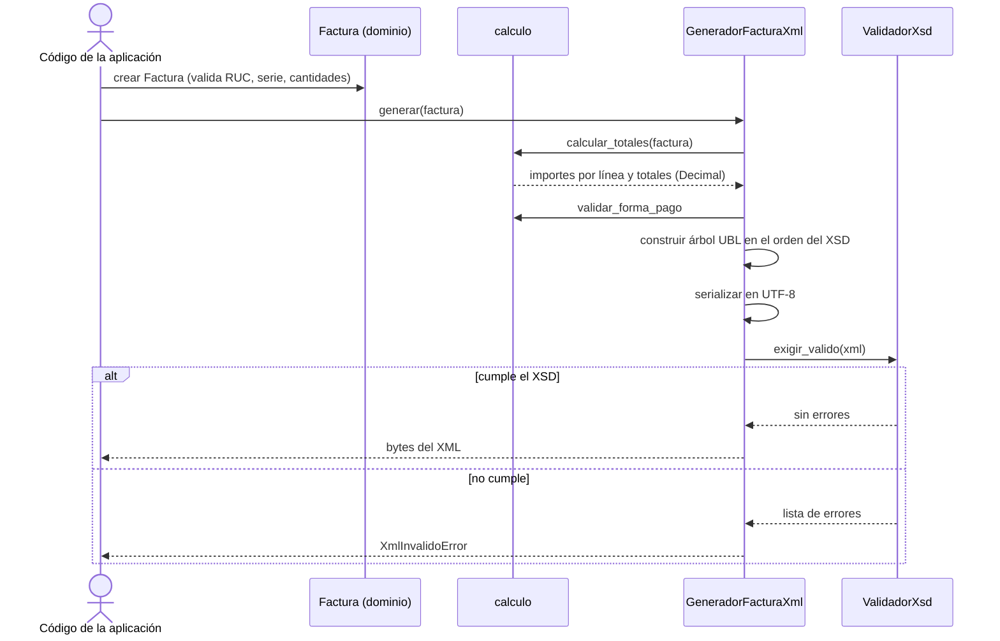

# Design 0009 · Generación de XML Invoice UBL 2.1

| Campo | Valor |
|---|---|
| **Spec asociada** | [`spec.md`](spec.md) |
| **Estado** | Implementado (referencia en Python) |

## 1. Resumen de la solución
El dominio (`Factura`) se convierte en un **árbol de elementos** `lxml` que respeta los espacios de nombres y el orden del XSD de `Invoice`; se serializa en UTF-8 y se **valida contra el XSD oficial** de OASIS antes de entregarlo (ADR-07). Es la implementación de referencia del puerto `IGeneradorUbl` (PT-11) de la arquitectura hexagonal: el dominio no conoce `lxml`.

## 2. Componentes por capa
| Capa | Componente | Responsabilidad |
|---|---|---|
| Dominio | `dominio.py` — `Factura`, `Emisor`, `Receptor`, `DetalleFactura`, `TipoAfectacion`, `FormaPago` | Datos del negocio y sus reglas (RUC, serie, cantidad, unidad) |
| Dominio | `calculo.py` — `calcular_totales`, `validar_forma_pago` | Importes con `Decimal`, redondeo half-up por línea, totales |
| Dominio | `monto_en_letras.py` | Leyenda 1000 |
| Adaptador (PT-11) | `generador_invoice.py` — `GeneradorFacturaXml` | Dominio → árbol UBL → bytes UTF-8 |
| Adaptador | `validador_xsd.py` — `ValidadorXsd` | Validación estructural contra el XSD |
| Datos | `specs/contracts/ubl-2.1/xsd/` | XSD oficiales con SHA-256 |

## 3. Puertos y adaptadores
| Puerto | Dirección | Adaptador inicial | Adaptador futuro |
|---|---|---|---|
| PT-11 `IGeneradorUbl` | salida | `GeneradorFacturaXml` (Python, `lxml`) | `UblXmlAdapter` .NET con clases generadas desde el XSD |
| (validación XSD) | salida | `ValidadorXsd` (`lxml`) | `XmlSchemaSet` de .NET |

## 4. Secuencia principal

## 5. Modelo de datos afectado
Ninguna base de datos. Entrada: objetos de dominio; salida: bytes XML.

## 6. Decisiones de diseño
| Decisión | Motivo |
|---|---|
| `Decimal`, nunca `float`; un `float` se rechaza al crear el detalle | Evita centavos perdidos (ADR-04) |
| Dataclasses inmutables (`frozen=True`) que validan en `__post_init__` | Una `Factura` que existe es coherente |
| Árbol `lxml`, no texto | Escape automático y namespaces correctos (ADR-07) |
| El validador se carga una sola vez (`lru_cache`) | El XSD pesa 2,8 MB y tarda en compilarse |
| `TipoAfectacion` es un `Enum` con su tributo, categoría y afectación | Una sola tabla para los cuatro tipos; el código no se repite |
| Tasa del IGV como parámetro con 18 % por defecto | No se generaliza el 10 % (vigencia por verificar) |
| XML sin `ds:Signature` | La firma es otra fase; `cac:Signature` ya referencia al firmante |

## 7. Alternativas consideradas
| Alternativa | Pros | Contras | Decisión |
|---|---|---|---|
| Plantillas de texto | Rápidas | Errores silenciosos; sin validación | Descartada (ADR-07) |
| `xsdata` (clases generadas del XSD) | Mismo principio que la propuesta .NET | ~69 000 líneas y 3 MB solo para `Invoice` (medido) | Descartada para la referencia |
| Árbol `lxml` + XSD | Pequeño y explicable | Las etiquetas se escriben a mano | **Elegida**; el XSD atrapa cualquier error |

## 8. Riesgos y mitigaciones
- Una etiqueta mal escrita → la validación XSD lo rechaza (probado con mutaciones).
- Cambio del XSD → `SHA256SUMS.txt` y la prueba de integridad lo detectan.
- Reglas tributarias que el XSD no ve → pruebas de importes y afectaciones.

## 9. Impacto en migración a Hexagonal / microservicios
El dominio no depende de `lxml`: solo el adaptador lo hace. Pasar a .NET exige reescribir el adaptador (PT-11) y el dominio, reutilizando los **mismos casos de prueba** (importes, afectaciones, XML de ejemplo).
