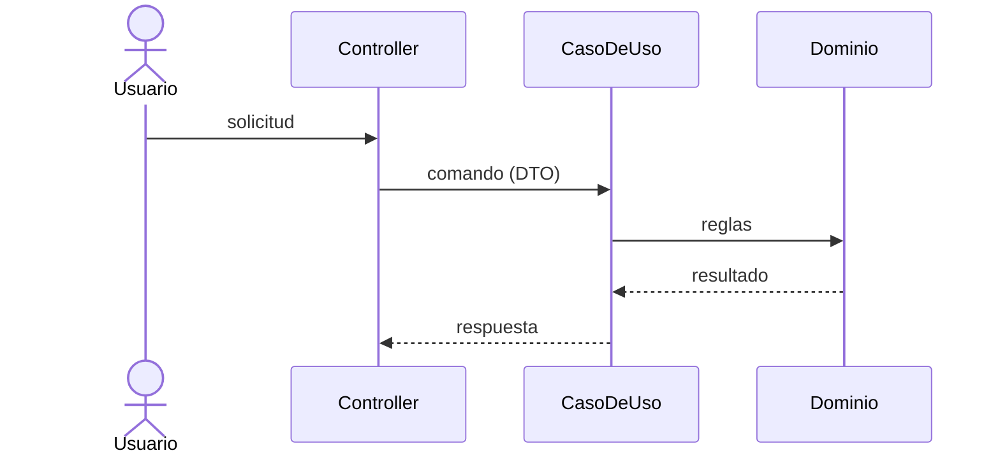

# Design NNNN · <Nombre de la feature / decisión>

| Campo | Valor |
|---|---|
| **Spec asociada** | `specs/features/NNNN-…/spec.md` |
| **Estado** | Propuesto · Aceptado · Reemplazado por … |

## 1. Resumen de la solución
Una frase: qué se construye y cómo encaja en el monolito MVC y en la visión Hexagonal.

## 2. Componentes por capa
| Capa | Componente | Responsabilidad |
|---|---|---|
| Web (MVC) | | |
| Application | | |
| Domain | | |
| Infrastructure | | |

## 3. Puertos y adaptadores
| Puerto | Dirección | Adaptador inicial | Adaptador futuro |
|---|---|---|---|

## 4. Secuencia principal

## 5. Modelo de datos afectado
Entidades/tablas nuevas o modificadas.

## 6. Alternativas consideradas
| Alternativa | Pros | Contras | Decisión |
|---|---|---|---|

## 7. Riesgos y mitigaciones
## 8. Impacto en migración a Hexagonal / microservicios
Qué queda desacoplado y qué costaría extraer.
